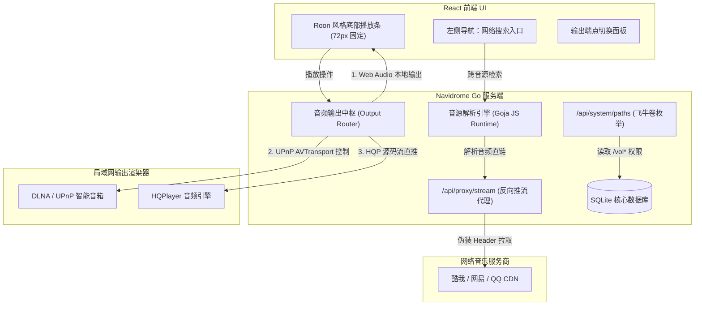

# Navidrome 深度定制与全功能扩展可行性调研与架构设计评估报告

> **项目名称**：Navidrome 飞牛私有云 (fnOS) 深度定制版  
> **更新时间**：2026-10-30  
> **目标定位**：在保持 Navidrome 核心轻量化、高性能架构的前提下，对系统进行针对性体验增强与发烧级音频流媒体平台扩展。包含：**飞牛授权目录枚举与默认库自愈**、**前端播放器移除浮动胶囊并固定底部常驻（类似 Roon）**、**局域网 DLNA 发现与 HQPlayer 源码直推**、以及**落雪式（LX Music）网络音乐源管理与全网搜歌集成**。

---

## 一、 评估核心内容与技术考量

### 1. 媒体库创建支持飞牛授权路径下拉选择与默认库自愈
- **当前现状**：
  - 官方前端 `ui/src/library/LibraryCreate.jsx` 使用纯文本输入框 `<TextInput source="path" />`；
  - 后端未暴露枚举服务器目录的端点；
  - 默认库（ID=1）受源码硬编码约束无法在界面修改或删除。
- **技术排查与落地方案**：
  1. **后端 API 扩展（目录枚举端点）**：
     - 在 `server/nativeapi/native_api.go` 的 `adminOnlyMiddleware` 路由组下新增只读端点 `GET /api/system/paths`；
     - 服务端通过读取飞牛 `/vol*` 路径及 `${TRIM_PKGVAR}/music_pool/`，结合 `syscall.Access(R_OK)` 过滤出具备读权限的真实绝对路径，返回标准 JSON 数组。
  2. **前端组件适配**：
     - 在 `ui/src/library/LibraryCreate.jsx` 中将 `path` 改为 Material-UI 的 `<Autocomplete freeSolo>`；
     - 挂载时拉取 `/api/system/paths` 作为下拉选项，同时保留手动输入兜底能力。
  3. **默认库路径自愈**：
     - 配置层统一将 `MusicFolder` 绑定至 `./var/music_pool`；
     - 启动脚本 `.fnos/cmd/main` 在服务拉起前自动创建池化软链接，并在启动时对老数据库执行快速 SQL 纠偏：
       ```bash
       sqlite3 "${DATA_DIR}/data/navidrome.db" "UPDATE library SET path='./var/music_pool' WHERE id=1 AND path NOT LIKE '%music_pool%';" 2>/dev/null || true
       ```

---

### 2. 前端播放器 UI 重构：去除浮动胶囊，固定底部常驻（对齐 Roon 交互）
- **当前现状**：
  - 原生播放器使用悬浮胶囊组件，移动端交互遮挡曲目列表、操作层级多，切歌与看词体验不佳。
- **技术排查与落地方案**：
  1. **移除浮动逻辑**：
     - 在 `ui/src/audioplayer/Player.jsx` 中移除或覆写 `toggleMode`、`bounds`、`defaultPosition` 配置，禁用原生库的 drag/move 与浮动胶囊折叠开关；
     - 在 `ui/src/audioplayer/styles.js` 及样式层强行锁定播放器容器为常驻底栏：
       ```css
       position: fixed !important;
       left: 0 !important;
       bottom: 0 !important;
       width: 100vw !important;
       height: 72px !important;
       transform: none !important;
       border-radius: 0 !important;
       z-index: 1300 !important;
       ```
  2. **三段式布局适配（保持整体 UI 风格不变，仅增强底栏布局）**：
     - **左侧**：专辑小封面（48x48）、歌名与歌手（长文本跑马灯滚动），并显示音质规格微标（FLAC / 采样率）；点击封面平滑唤起全屏歌词大图面板；
     - **中间**：完整播控中枢（随机、上一首、播放/暂停圆形按钮、下一首、循环模式，以及实时进度条与时间提示）；
     - **右侧**：播放队列抽屉入口、音量调节滑块、音频输出端点切换器。
  3. **主视图防遮挡避让**：
     - 将 `ui/src/layout/Layout.jsx` 与 `ui/src/layout/Menu.jsx` 中的 `paddingBottom` 由动态判断固化为恒定 `80px`，确保页面滚动到底部时最后一首歌曲永不被播放条遮挡。

---

### 3. 音频输出设置：集成 DLNA 发现与 HQPlayer 源码推流
- **业务需求**：在前端设置或播放条右侧增加“音频输出设备”管理面板，支持：
  - 本地设备播放（Web Audio / 默认）；
  - **DLNA/UPnP 设备自动发现与推流**：扫描局域网内可用的 DLNA 渲染器（Renderer），支持添加并选中后将音频流推送给局域网音箱/数播；
  - **HQPlayer 节点接入与源码推流**：用户手动输入 HQPlayer 的 IP 与端口后添加为输出端点；选中后通过 HQPlayer 专有控制协议/API 发送播放指令与音频流，实现源码直推。
- **技术排查与落地方案**：
  1. **架构边界划分**：
     - 浏览器前端受限于无法发送 UDP 组播（SSDP `239.255.255.250:1900`）以及 CORS 跨域限制，**必须在 Go 后端实现输出调度核心**；
     - 后端新建 `core/output/dlna/` 与 `core/output/hqplayer/`，提供统一的设备枚举与推流代理接口。
  2. **源码直推与传输格式**：
     - 推送给 HQPlayer 时彻底绕过 ffmpeg 转码管线，`core/stream/media_streamer.go` 以 RAW 模式提供原格式数据，保证 PCM/FLAC/DSD 源码高保真无损直达。
  3. **状态双向同步**：
     - 后端维持状态轮询，通过 Navidrome 原生 SSE 事件流广播播放进度，前端播放条与外部设备实时同步。

---

### 4. 类似落雪音乐（LX Music）的网络音乐源管理与全网搜歌集成
- **业务需求**：
  - **网络音乐源管理**：设置中增加音源管理面板，支持导入用户自定义 JavaScript 规则源或标准 API；
  - **左侧导航栏新增入口**：主界面左侧菜单中新增“网络搜索”模块；
  - **跨音源聚合搜索**：跨源检索曲目信息、音质规格（128k/320k/FLAC）；
  - **消费闭环**：支持“立即试听推流”与“收藏添加到现有本地歌单”。
- **技术排查与落地方案**：
  1. **脚本执行环境与安全沙盒**：
     - **优选后端 Goja JS 虚拟机**：避免浏览器端请求第三方接口遭遇跨域（CORS）拦截，在 Goja 中注入网络与加密 Polyfill，安全隔离执行解析。
  2. **混合媒体流与数据模型冲击**：
     - 采用**网络曲目虚拟落库（Virtual MediaFile）机制**：网络歌曲赋予专属 ID 前缀（`net_lx_...`），在 `media_file` 标记 `is_remote = 1`；
     - 歌单关联表 `playlist_tracks` 原生基于 `media_file_id`，因此可直接添加网络曲目，与本地物理文件无缝混排。
  3. **流媒体解析与反防盗链代理**：
     - 后端提供统一中继端点 `/api/proxy/stream`，根据平台伪装 `Referer` / `User-Agent`，并支持时效性 Token 自动静默刷新与 HTTP 206 断点续传。

---

## 二、 系统架构链路图



---

## 三、 各模块影响范围与源码清单

| 改造模块 | 核心改动文件 | 改动性质 | 上游合并冲突评估 |
| :--- | :--- | :--- | :--- |
| **1. 飞牛授权目录枚举与自愈** | • 后端：`server/nativeapi/native_api.go`, 新建 `server/nativeapi/system_paths.go`<br>• 前端：`ui/src/library/LibraryCreate.jsx`<br>• 脚本：`.fnos/cmd/main` | 新增只读端点 + 前端组件适配 | **极低**（仅挂载新只读端点，不碰核心实体） |
| **2. 固定底部常驻播放条** | • 前端核心：`ui/src/audioplayer/Player.jsx`<br>• 样式层：`ui/src/audioplayer/styles.js`<br>• 布局避让：`ui/src/layout/Layout.jsx`, `ui/src/layout/Menu.jsx` | 样式重构 + 交互改造 | **低至中**（保持原风格，仅固定底栏容器并调整安全内边距） |
| **3. DLNA 与 HQPlayer 推流** | • 后端：新建 `core/output/dlna/`, `core/output/hqplayer/`<br>• 调度：`core/stream/media_streamer.go`, `server/nativeapi/native_api.go`<br>• 前端：新建 `ui/src/audioplayer/OutputDeviceSelector.jsx` | 独立扩展包新增 | **低**（作为独立 package 注入，不影响核心流媒体逻辑） |
| **4. LX Music 网络源与全网搜歌** | • 后端：新建 `core/musicprovider/` (Goja JS 虚拟机)<br>• 路由：`server/nativeapi/` (新增搜索与推流代理)<br>• 数据库：新增迁移 SQL（`media_file` 增加 `is_remote` 列）<br>• 前端：新建 `ui/src/netsearch/`, `ui/src/settings/SourcesTab.jsx` | 深度集成扩展 | **中至高**（修改了数据表与侧边栏路由） |

---

## 四、 阶段划分与实施路线图

```
+-----------------------------------------------------------------------------------+
| 阶段一：飞牛系统体验深度融合 (目录下拉选择 + 默认库无感自愈)                   |
| 周期：1~2天 | 风险：极低 | 解决授权目录查找痛点与初次部署不可修改问题              |
+-----------------------------------------------------------------------------------+
                                         │
                                         ▼
+-----------------------------------------------------------------------------------+
| 阶段二：前端播控交互升级 (移除悬浮胶囊，固定底部常驻底栏)                       |
| 周期：2~3天 | 风险：低   | 保持整体 UI 视觉风格，解除悬浮遮挡并统一列表避让         |
+-----------------------------------------------------------------------------------+
                                         │
                                         ▼
+-----------------------------------------------------------------------------------+
| 阶段三：Hi-Fi 音频输出架构实现 (DLNA 发现推流 + HQPlayer 源码直推)             |
| 周期：5~7天 | 风险：中   | 局域网组播发现与后端中继代理，打通发烧音响硬核链路       |
+-----------------------------------------------------------------------------------+
                                         │
                                         ▼
+-----------------------------------------------------------------------------------+
| 阶段四：网络音乐生态集成 (LX Music 脚本源管理 + 全网聚合搜索 + 虚拟曲目入库)    |
| 周期：7~10天| 风险：高   | Goja 虚拟机沙盒、防防盗链代理、本地歌单混排消费闭环     |
+-----------------------------------------------------------------------------------+
```
